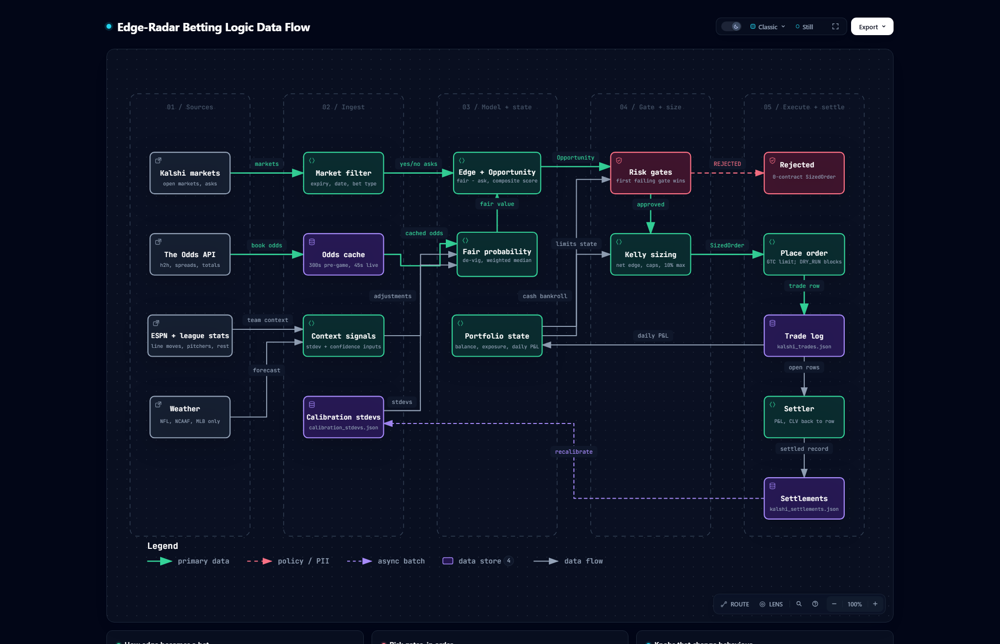

# 🧭 Diagrams

<p align="center">
  
  
  <a href="../README.md"></a>
</p>

## Betting logic data flow

[](betting-data-flow.html)

How a Kalshi market becomes a bet: the four sources, the odds cache and context signals, fair
probability and edge, the risk gates, Kelly sizing, the order, and settlement feeding calibration
back. Below the map, three cards cover how edge becomes a bet, the risk gates in order, and the
knobs that change behaviour.

**See it on the [homepage](https://edge-radar.ai-automation-tools.dev/#pipeline)**, or open the interactive version: [`betting-data-flow.html`](betting-data-flow.html) in a browser
from a clone, or [render it from GitHub](https://raw.githack.com/ai-automation-tools/edge-radar/master/docs/diagrams/betting-data-flow.html).
Each box links to the exact lines it describes, at the pinned commit. It also has route tracing,
search, light/dark, and SVG/PNG export.

> [!NOTE]
> The diagram shows the code's defaults and structure. The live `.env` overrides several limits,
> so `python scripts/doctor.py` is still the source of truth for what is actually running.

## Files

| File | What it is | Edit it? |
|:---|:---|:---|
| [`betting-data-flow.json`](betting-data-flow.json) | The source: every node, flow, card, and the code each node cites | **Yes, this is the only file you edit** |
| `betting-data-flow.html` · `.png` | Generated: the interactive diagram, which the homepage embeds live, and a static PNG snapshot | Never; rebuild |
| `site/diagram/betting-data-flow.html` · `.png` | Copies the build writes for the homepage, which deploys only `site/`. `--check` flags a copy that differs | Never; rebuild |
| `betting-data-flow.delivery.json` · `.sources.lock.json` | Build receipt, and the git blob of every cited file at the pinned commit | Never; rebuild |
| [`scripts/diagrams/build_betting_diagram.py`](../../scripts/diagrams/build_betting_diagram.py) | Builds the diagram and checks it for drift | Only to change how it builds or checks |

## Keeping it current

Every node cites code by path and line range, pinned to the commit in `meta.repository.revision`.
When a cited file changes, the diagram may be describing logic that moved or no longer exists, so
it counts as stale until someone has re-read that code.

| When | What catches it |
|:---|:---|
| **A commit touches `scripts/` or `app/`** | The `betting-diagram-drift` pre-commit hook prints which cited files changed. It warns and never blocks |
| **Any time** | `python scripts/diagrams/build_betting_diagram.py --check` exits 1 and names the stale files |
| **Weekly** | The repo owner's doc drift check runs `--check` on the local clone and emails any issue |

To bring it up to date:

1. Commit the code change first. Evidence is pinned to committed bytes, never to working-tree edits.
2. Re-read each changed file the check named. In `betting-data-flow.json`, fix the line ranges in
   `sources`, and any label, sublabel, flow or card the change made untrue. Add a node when a new
   stage joins the betting path, and remove one when a stage goes. Keep the existing ids.
3. Rebuild, re-pinning to the commit you just read:

   ```bash
   python scripts/diagrams/build_betting_diagram.py --pin-head
   ```

4. Commit the JSON, the generated files and the `site/diagram/` copies together, and add a line to `docs/CHANGELOG.md`.

Building needs Node 18+, Chrome, and the [Archify](https://github.com/tt-a1i/archify) skill
(default path `~/.claude/skills/archify/bin/archify.mjs`; pass `--archify <path>` to point elsewhere).
The check needs only git. A failed build exits 1 and leaves the last good HTML and PNG in place;
the reason is in `docs/diagrams/.build/betting-data-flow.finalize-summary.json`.

---

<p align="center">
  <a href="../README.md">← Docs index</a> ·
  <a href="../setup/ARCHITECTURE.md">Architecture →</a>
</p>
